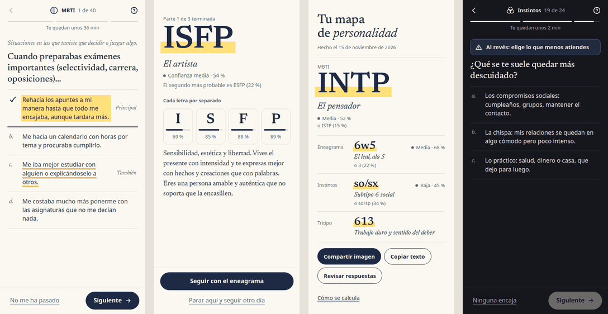

# Tu mapa de personalidad

Test de autoconocimiento a partir de situaciones reales: tipo **MBTI**, **eneatipo** con su ala, **orden de instintos** y **tritipo**. Es una web estática: sin registro, sin cookies y sin servidor. Las respuestas no salen del navegador.

**Pruébalo:** https://josuualtamirano.github.io/mapa-personalidad/



## Qué hace

- Entre 109 y 124 preguntas, según haga falta desempatar, en unos 36 minutos. Se puede parar y seguir otro día, o en otro dispositivo con un código.
- Calcula probabilidades calibradas para cada tipo y añade preguntas de desempate cuando los dos primeros resultados quedan cerca.
- Muestra el resultado de cada parte al terminarla y, al final, tu retrato: la confianza de cada resultado y el segundo más probable.
- Explica cada sistema en su pestaña, con figuras accesibles, y permite elegir entre dos tipos empatados, consultar un glosario, compartir una imagen, imprimir, repetir una parte y comparar el resultado con el de otra persona.

## Cómo está hecho

- **HTML, CSS y JavaScript sin frameworks ni compilación.** Son cuatro scripts clásicos (`data.js`, `texts.js`, `model.js` y `app.js`), así que la web funciona en cualquier hosting estático y pesa unos 275 KB sin comprimir, fuentes incluidas.
- **El cálculo es intocable:** `data.js` y `model.js` son los de la versión anterior. Sus pruebas (`node tests/run.mjs`) se pasan en cada cambio, y GitHub Actions no publica si fallan.
- **Accesible (WCAG 2.2 AA)** en móvil, tableta y escritorio, en claro y en oscuro:
  - teclado completo y foco gestionado;
  - anuncios para lector de pantalla;
  - contraste comprobado y respeto al movimiento reducido.

  Se comprueba con axe-core.
- **Diseño «Diario»:** un cuaderno que se rellena contigo. Tinta sobre papel, Newsreader para los títulos y lo tuyo marcado con rotulador amarillo.
- **Privacidad:** nada de analíticas, CDN ni peticiones a terceros. La fuente (Newsreader, licencia OFL) está alojada en la propia web.

## Carpetas

| Carpeta | Contenido |
|---|---|
| `web/` | La web publicada |
| `tests/` | Pruebas del cálculo: `node tests/run.mjs` |
| `dev/` | Pruebas de interfaz con Playwright y axe-core (ver [dev/LEEME.md](dev/LEEME.md)) |
| `base/` | La versión anterior, de referencia |
| `bocetos/`, `referencia/` | Bocetos del rediseño y capturas de la versión anterior |
| [ESPECIFICACION.md](ESPECIFICACION.md) | Especificación del rediseño, hecho en tres fases |

## Probarlo en local

```bash
python3 -m http.server 8765
```

Después abre http://localhost:8765/web/. También funciona abriendo `web/index.html` directamente, aunque entonces el navegador usa la fuente del sistema.

## Aviso

Es un test de autoconocimiento, no un diagnóstico. MBTI® es una marca registrada de The Myers-Briggs Company; este test no es el oficial. Los grupos del eneagrama siguen a Don Riso y Russ Hudson; los subtipos, a Claudio Naranjo; el concepto de tritipo es de Katherine Chernick Fauvre.
